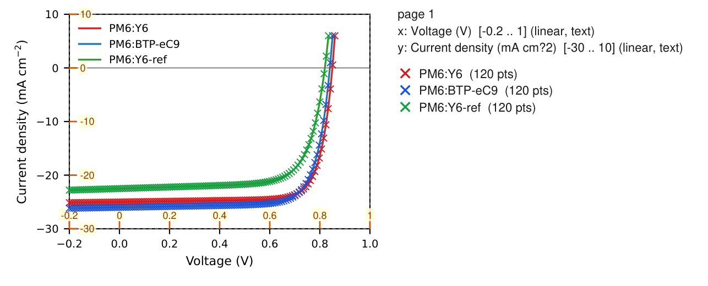

# Figrip · 论文矢量曲线数据提取工具

[](https://github.com/Ho-boop/figrip/actions/workflows/tests.yml)


[](LICENSE)

**读取 PDF 的矢量路径与坐标刻度，恢复 J–V、EQE 等曲线，输出数据、校验预览和光伏参数。**

科研工作中，复用论文曲线通常需要截图、手动标定和逐点拾取。Figrip 直接解析出版 PDF 中的绘图指令，通过刻度拟合页面坐标到数据坐标的变换，再提取曲线与标记点。输出可接入 Excel、Origin 和已有器件性能处理工具。

这是一个使用 AI 辅助开发的科研工具项目：需求拆解为 PDF 解析、坐标轴标定、曲线提取、应用输出和测试语料模块；以明确的数据接口、合成真值和真实论文评测验证交付。

> **v0.1.0 为早期 alpha。恢复的是论文绘图中的数据表示，精度受刻度识别、路径处理和曲线归属影响，并非原始实验数据或“零误差”。双 Y 轴自动提取尚未完成。使用真实论文数据前需核对叠加预览。**

## 可运行的演示

下图由仓库自生成的 J–V 模型曲线产生，彩色点为恢复结果；没有使用受版权保护的论文图片。



```bash
git clone https://github.com/Ho-boop/figrip.git
cd figrip
python -m venv .venv
# Windows PowerShell: .\.venv\Scripts\Activate.ps1
# macOS / Linux: source .venv/bin/activate
python -m pip install -e ".[dev]"
python tools/demo.py
```

演示生成普通 J–V、轮廓文字/填充曲线 J–V 和 EQE 三种 PDF，运行提取与真值比较，输出到 `out/demo/`：

- `inputs/`：自生成 PDF 与真值 JSON。
- 各案例目录：CSV、JSON、Origin TXT、叠加预览 PNG；J–V 案例另有器件参数 TXT。
- `report.json`：每个案例的曲线误差评分，及 J–V 参数与模型真值的对照。

脚本在提取不符合真值容差、CLI 失败或产物缺失时返回非零状态。

## 功能与实现

| 环节 | 实现 | 当前边界 |
|---|---|---|
| PDF 解析 | PyMuPDF 提取路径、文本和图像；贝塞尔曲线离散为折线 | 读取矢量数据，位图不提供曲线顶点 |
| 坐标标定 | 轴线/刻度几何检测，线性与对数拟合，倒置轴和手动刻度 | 无轴线、无数值刻度、复杂断轴仍可能漏检 |
| 轮廓文字 | 数字字形模板匹配；可选 RapidOCR 回退 | 旋转字形、复杂轴标题和图例名仍有缺失 |
| 曲线提取 | 描边路径、填充轮廓中心线、标记点及图例匹配 | 碎线、空心标记、注释污染和曲线归属是主要待改进项 |
| 科研计算 | Jsc / Voc / FF / PCE，EQE 与 AM1.5G 光谱积分 | 依赖输入单位与曲线提取正确性 |
| 数据交付 | CSV、带标定信息的 JSON、Origin TXT、校验 PNG、器件参数 TXT | EQE 积分目前通过 Python API 调用 |

核心提取不需要模型 API、账号或密钥。轮廓字形识别包含本地模板匹配，不强制安装 OCR 引擎。

## 在自己的论文上使用

只需提取功能时，可运行 `python -m pip install .`；可选像素 OCR：`python -m pip install ".[ocr]"`。
CLI 页码从 **1** 开始；Python API 的 `pages` 从 **0** 开始。

```bash
# 查看第四页识别到的图和曲线
python -m figrip scan paper.pdf -p 4

# 选择面板 d，导出所有格式和叠加预览
python -m figrip extract paper.pdf -p 4 --panel d -o out/paper --format all --preview

# 计算光伏参数；Pin 单位为 mW/cm²
python -m figrip jv paper.pdf -p 4 --panel d --pin 100 -o out/jv

# 读不出刻度时，指定绘图区和刻度；y 按页面从下到上的顺序给出
python -m figrip extract paper.pdf -p 4 --bbox 60,30,260,190 --x-ticks "0,0.2,0.4,0.6,0.8" --y-ticks "0,-5,-10,-15,-20"
```

`--panel` 接受面板字母或该页从 1 开始的面板序号；`--xscale log` / `--yscale log` 可指定对数轴。
CLI 返回码：`0` 成功，`1` 提取异常，`2` 输入或参数错误，`3` 没有可报告的图/曲线。

```python
from figrip.pipeline import extract
from figrip.opv import jv_metrics, eqe_integrated_jsc

figures = extract("paper.pdf", pages=[3])
curve = figures[0].series[0].data
metrics = jv_metrics(curve[:, 0], curve[:, 1], pin=100)
# 单独计算 EQE 积分电流（波长 nm，EQE %）
# jsc = eqe_integrated_jsc(wavelength_nm, eqe_percent)
```

## 验证与实测边界

2026-10-09 在本地 Windows / Python 3.14.2 重新运行：**151 项测试通过**。包含：

- 19 类具有精确真值的自生成案例，覆盖线性/对数轴、负刻度、倒置轴、多面板、轮廓字和填充曲线；曲线评分容差为轴范围的 0.5%。
- 光伏参数模型验证、CLI、导出与异常路径测试。
- 本地具备论文文件时，运行 Zheng 2018 图与 Table 2 参数对照；论文缺失则自动跳过，PDF 不随仓库发布。

2026-10-08 第一轮真实论文评测是历史基线，**不是第二轮修复后的结果**：

| 指标 | 基线 |
|---|---:|
| 页数 / 论文数 / 真实矢量图 | 60 / 39 / 177 |
| 正确定位真实图 | 154 / 177 = 87.0% |
| 检出面板中的完整正确提取 | 96 / 164 = 58.5% |
| 全部真实图中的完整正确提取 | 96 / 177 = 54.2% |
| 检出真实图的坐标标定正确 | 152 / 154 = 98.7% |
| 每页中位耗时 / 崩溃 / 超时 | 2.5 s / 0 / 0 |

评测是对样本叠加图的人工判读，样本偏向矢量路径较多的 OPV 论文，不代表所有论文类型。详见 [评测报告与失败分类](docs/eval-2026-10.md)。

```bash
python -m pytest -q
# 对自己的 PDF 库评测；保留同一 out 目录以复用 selection.json
python -I tools/eval_library.py --library "path/to/papers/*.pdf" --out out/eval --sheets
```

## 接下来做什么

优先修复双 Y 轴右轴标定和曲线归属、碎线合并/去重、空心标记分组、轮廓文字误提取；随后用固定样本重跑评测。数据模型已有 `Panel.y2` 和 `Series.axis`，自动检测与分配尚未接通。

位图、柱状图、面积图、热图和复杂断轴不承诺支持；图例名称和面板字母可能缺失。**单元测试通过不等同于任意真实论文都能正确提取。**

详见 [路线图](docs/ROADMAP.md)、[架构](docs/ARCHITECTURE.md)、[贡献说明](CONTRIBUTING.md) 和 [变更记录](CHANGELOG.md)。

## English overview

Figrip recovers plotted data from vector paths inside PDF papers, calibrates linear/log axes, exports CSV/JSON/Origin files, and renders overlays for inspection. An OPV toolbox computes J–V metrics and EQE-integrated current. It runs locally without a model API or credentials.

This is an early alpha, not a lossless recovery of original measurements. The synthetic demo is reproducible without a private paper library. Twin-y extraction is unfinished; fragmented curves and markers remain important failure modes. The real-paper baseline above reports panel detection and fully correct extraction separately.

## 许可与数据来源

项目自身代码采用 [MIT](LICENSE)。参考光谱的来源及 BSD 许可声明见 [THIRD_PARTY_NOTICES.md](THIRD_PARTY_NOTICES.md)。运行依赖按各自许可分发；PyMuPDF 的许可独立于本项目代码许可。论文原文件和论文预览不随仓库发布，演示素材由代码生成。
