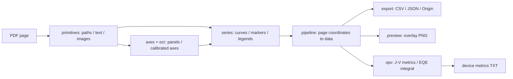

# Figrip 架构

## 数据流

## 模块接口

| 模块 | 输入 → 输出 | 责任 |
|---|---|---|
| `primitives.extract_page` | PyMuPDF page → `PageContent` | 将描边/填充路径、文本和位图统一为页面几何 |
| `axes.find_panels` | `PageContent` + 可选 page/hints → `list[Panel]` | 找绘图区、刻度、轴变换、标题和面板字母 |
| `ocr` | 轮廓字形或局部渲染 → 标签候选 | 字形模板匹配与可选像素 OCR |
| `series.extract_series` | `PageContent` + `Panel` → `list[Series]` | 提取页面坐标中的曲线，识别样式及图例 |
| `pipeline.extract` | PDF + 页号/标定提示 → `list[FigureResult]` | 编排提取并映射到数据坐标 |
| `opv` | 已核对曲线、单位及入射光强 → 指标/积分电流 | Jsc/Voc/FF/PCE 与 EQE 积分 |
| `export` / `preview` | `FigureResult` → 文件 | 导出数据、标定信息与校验图 |
| `cli` | 命令行 → 管线/API 调用 | 输入校验、面板选择、返回码和交付 |

## 坐标与数据模型

所有共享类型在 `figrip/model.py`。页面坐标采用 PyMuPDF points：左上角为原点，y 向下。
API 页号从 0 开始，CLI 从 1 开始。一个 `Panel` 包含绘图区和 x/y 轴标定；一个 `Series` 保存页面点、数据点、样式和路径来源。

- 线性轴：`value = a * position + b`。
- 对数轴：`log10(value) = a * position + b`。
- 残差按刻度间距归一化，用于筛掉不合理标定；不是完整曲线准确度评分。
- 曲线误差通过合成语料真值独立评分；不能用刻度残差代替。

`Panel.y2`、`AxisCalib.color`、`Series.axis` 是双 Y 轴扩展接口。目前 `axes.py` 只在部分情形中报告右轴被忽略，`series.py` 尚未自动分配右轴曲线。**接口存在不代表功能完成。**

## 验证设计

`tests/corpus/make_corpus.py` 生成 19 类 PDF 和真值。`score.py` 匹配绘图区和系列，比较恢复曲线与真值。
`tools/demo.py` 复用语料生成器，展示普通/轮廓 J–V 与 EQE，并验证输出文件及数值。
`tools/eval_library.py` 扫描用户指定 PDF 库，在子进程中设置单页超时，保存样本选择、运行记录和叠加图，供人工判读。

合成测试保证可复现，真实论文评测捕捉排版与绘图工具造成的复杂性；二者分别报告。
本地真实论文回归缺少文件时跳过，不发布原始 PDF 或私有库预览。

## 开发方式与当前状态

初始实现采用 AI 多任务协作，按 PDF 基础层、轴标定、曲线、应用和测试语料划分模块，统一数据模型后集成验证。
2026-10-08 完成第一轮实现和真实样本评测，随后加入双 Y 轴数据模型；第二轮算法修复被会话中断。
2026-10-09 完成仓库交付整理、可复现演示与自动测试配置。待办以 [ROADMAP.md](ROADMAP.md) 为准。
